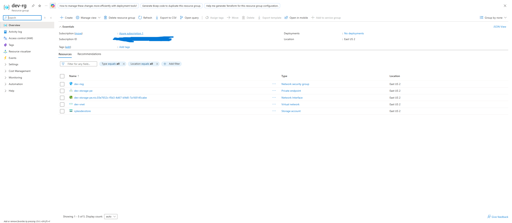
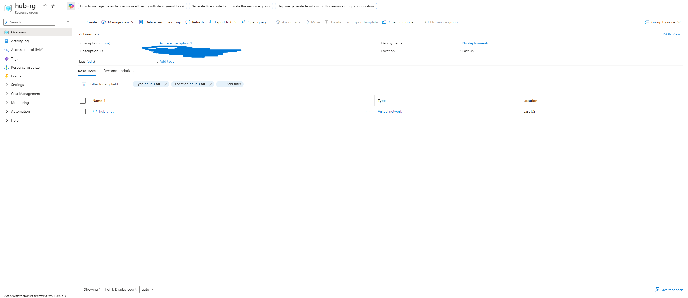
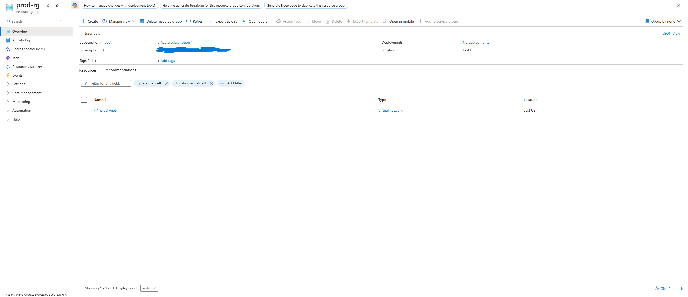
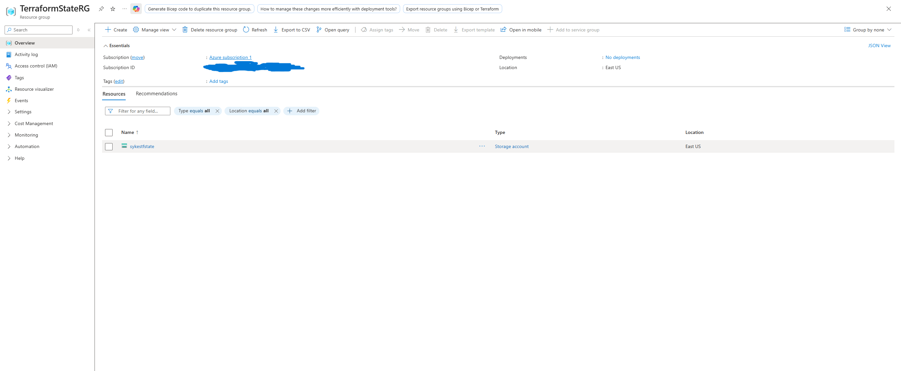
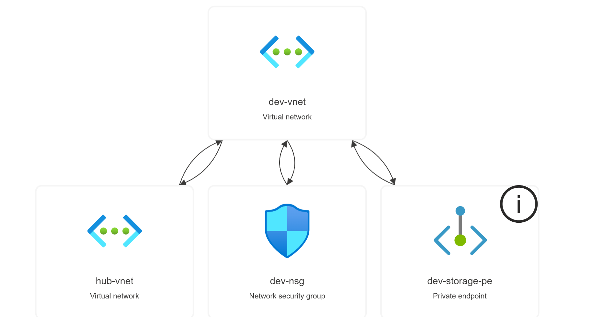
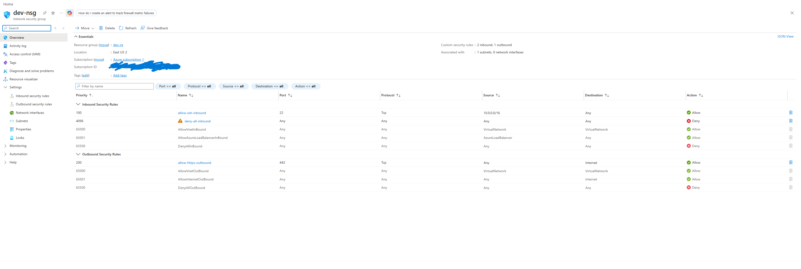
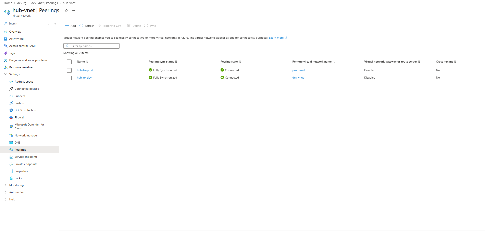
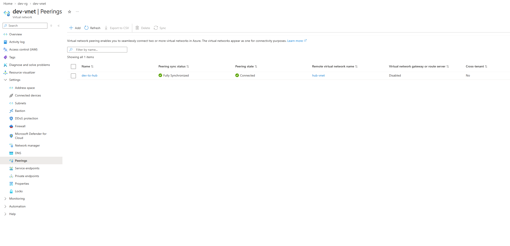
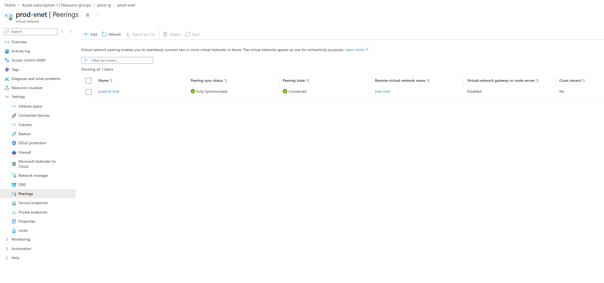

# 🏗️ Personal Azure Infrastructure with Terraform IaC
### Hub & Spoke Network · NSGs · Private Endpoint · Remote State


---

## Overview

This project defines a secure, repeatable Azure environment entirely in Terraform: no portal clicks to build it, and every resource lives in code under version control. Hub and spoke networking, a least-privilege network security group, a storage account reachable only through a private endpoint, and Terraform state kept in Azure Blob Storage.

It is the next step after my CLI-based work in [Linux to Azure: Automated Log Backup](https://github.com/MrBSykes/linux-to-azure-automated-syslog-backup). That project built and verified resources by hand with the Azure CLI. This one defines them as code so the same environment can be rebuilt or destroyed with one command.

**Status:** 17 resources deployed and tracked in Terraform state. The Linux VM is written but not deployed (see [What is and is not built](#what-is-and-is-not-built)).

Full write-up: [`docs/personal-azure-infrastructure-terraform-documentation.pdf`](docs/personal-azure-infrastructure-terraform-documentation.pdf) (9 pages: business problem, architecture, walkthrough, troubleshooting log).

---

## Architecture

```
                  ┌───────────────────────────┐
                  │ hub-vnet  10.0.0.0/16     │
                  │ GatewaySubnet 10.0.0.0/24 │
                  └─────────┬───────────┬─────┘
                  VNet peering         VNet peering
                  (both directions)    (both directions)
              ┌─────────────┘           └─────────────┐
   ┌──────────▼───────────┐                ┌──────────▼───────────┐
   │ dev-vnet 10.1.0.0/16 │                │ prod-vnet 10.2.0.0/16│
   │ private-subnet       │                │ private-subnet       │
   │  10.1.1.0/24         │                │  10.2.1.0/24         │
   │  ├ dev-nsg           │                │  (no NSG or          │
   │  └ dev-storage-pe ───┼─► sykesdevstore│   resources yet)     │
   └──────────────────────┘   (public      └──────────────────────┘
                               access denied)

Remote state: TerraformStateRG / sykestfstate / tfstate
```

Dev and prod are peered only to the hub, never to each other, so a compromise in one spoke has no direct path to the other.

---

## What is and is not built

| # | Component | Status |
|---|---|---|
| 1 | Hub and spoke VNets with bidirectional peering (hub-dev, hub-prod) | ✅ Deployed |
| 2 | Network security group on the dev private subnet (default deny inbound, SSH only from the hub range, HTTPS outbound) | ✅ Deployed |
| 3 | Storage account `sykesdevstore` with public access denied, plus a blob private endpoint in the dev subnet | ✅ Deployed |
| 4 | Remote state in Azure Blob Storage (`sykestfstate`) | ✅ Deployed |
| 5 | Linux VM in the dev private subnet, no public IP | ⏸ Code written, commented out. Azure free tier had no B-series capacity in East US or East US 2 |
| 6 | Azure Bastion in the hub | 🔲 Planned |
| 7 | NSG and storage account in the prod spoke | 🔲 Planned |
| 8 | Refactor into modules, dev/prod tfvars | 🔲 Planned |

---

## Repository Layout

```
.
├── README.md
├── terraform/
│   ├── main.tf                    # all resources and the remote backend
│   ├── variables.tf               # subscription_id
│   ├── terraform.tfvars.example   # copy to terraform.tfvars (gitignored)
│   └── .terraform.lock.hcl        # pins provider versions
├── docs/
│   └── personal-azure-infrastructure-terraform-documentation.pdf
└── screenshots/                   # 10 Azure portal screenshots of the deployed resources
```

The project is a single flat configuration today. Splitting it into modules and per-environment folders is on the roadmap, not done.

---

## Resources deployed

| Area | Resources |
|---|---|
| Resource groups | `hub-rg` (East US), `dev-rg` (East US 2), `prod-rg` (East US) |
| Networks | `hub-vnet` 10.0.0.0/16, `dev-vnet` 10.1.0.0/16, `prod-vnet` 10.2.0.0/16 |
| Subnets | `GatewaySubnet` 10.0.0.0/24, dev `private-subnet` 10.1.1.0/24, prod `private-subnet` 10.2.1.0/24 |
| Peerings | hub-to-dev, dev-to-hub, hub-to-prod, prod-to-hub |
| Security | `dev-nsg` plus its association to the dev private subnet |
| Storage | `sykesdevstore` (TLS 1.2, network default action Deny) and `dev-storage-pe` private endpoint |
| State | `TerraformStateRG` / `sykestfstate` / container `tfstate` (created with the CLI before Terraform) |

### NSG rules (`dev-nsg`)

| Rule | Priority | Direction | Source | Port | Action |
|---|---|---|---|---|---|
| allow-ssh-inbound | 100 | Inbound | 10.0.0.0/16 (hub range) | 22 | Allow |
| allow-https-outbound | 200 | Outbound | Any | 443 to Internet | Allow |
| deny-all-inbound | 4096 | Inbound | Any | Any | Deny |

Outbound traffic falls back to Azure's default rules, so there is no explicit deny-all-outbound rule.

---

## Setup

### Prerequisites

- Terraform (`winget install HashiCorp.Terraform` on Windows)
- Azure CLI, signed in with `az login`
- An Azure subscription where you can create resources

### 1. Create the remote state backend (once, with the CLI)

```bash
az group create --name TerraformStateRG --location eastus

az storage account create \
  --name sykestfstate \
  --resource-group TerraformStateRG \
  --location eastus \
  --sku Standard_LRS \
  --min-tls-version TLS1_2

az storage container create \
  --name tfstate \
  --account-name sykestfstate
```

Storage account names are globally unique, so use your own name and update the `backend` block in `terraform/main.tf` to match.

### 2. Set your subscription

```bash
cd terraform
cp terraform.tfvars.example terraform.tfvars   # then put your subscription ID in it
```

`terraform.tfvars` is gitignored so the ID stays out of the repo.

### 3. Run Terraform

```bash
terraform init      # downloads the provider, configures the backend
terraform plan      # shows what will be created
terraform apply     # builds it
terraform destroy   # tears it down
```

---

## Screenshots

| # | Screenshot | What it shows |
|---|---|---|
| 01 |  | `dev-rg`: NSG, private endpoint and its NIC, VNet, storage account |
| 02 |  | `hub-rg`: hub VNet |
| 03 |  | `prod-rg`: prod VNet |
| 04 |  | `TerraformStateRG`: the state storage account |
| 05 |  | Resource visualizer: dev VNet linked to hub VNet, NSG and private endpoint |
| 06 |  | `dev-nsg` inbound and outbound rules |
| 07 |  | `sykesdevstore`: TLS 1.2, one private endpoint connection, public access limited |
| 08 |  | Hub peerings to prod and dev: Connected, Fully Synchronized |
| 09 |  | Dev to hub peering: Connected |
| 10 |  | Prod to hub peering: Connected |

---

## Troubleshooting Log

| # | Issue | Root cause | Resolution |
|---|---|---|---|
| 1 | `terraform init`: `az` executable not found | Azure CLI was on the Ubuntu box, not the Windows machine running Terraform | Installed Azure CLI on Windows and restarted VS Code |
| 2 | `plan` failed registering resource providers | Free tier lacks permission for automatic registration | Registered Microsoft.Network, Compute and Storage with `az provider register` |
| 3 | ED25519 SSH key rejected for the VM | Azure Linux VMs accept only RSA keys | Generated a dedicated RSA 4096 key for Azure |
| 4 | `SkuNotAvailable` for B1s and B1ms | No free-tier B-series capacity in East US or East US 2 | Commented the VM out; code is kept for later |
| 5 | Peering "inconsistent result" after changing dev to East US 2 | Peering existed in Azure but was no longer in state | Brought it back with `terraform import` |
| 6 | Push rejected: provider binary over 100 MB | `.terraform/` was committed before a `.gitignore` existed | Added `.gitignore`, removed the binary from history with `git filter-branch`, force pushed |

The full table with business lessons is in the PDF.

---

## Skills Demonstrated

Infrastructure as Code (Terraform), Azure hub and spoke networking, VNet peering, NSG design, private endpoints, remote state management, importing existing resources into state, Git hygiene for IaC projects, and written troubleshooting documentation.

**Certifications this supports:** AZ-900 (passed September 24, 2026) and CompTIA Security+. It also lines up with the AZ-104 networking domain, which is the next goal.

---

## Next Steps

- [ ] Deploy the Linux VM when capacity is available
- [ ] Add Azure Bastion to the hub
- [ ] Add an NSG and storage account to the prod spoke
- [ ] Refactor into modules with separate dev and prod tfvars

---

## Related Projects

- [Linux to Azure: Automated System Log Backup](https://github.com/MrBSykes/linux-to-azure-automated-syslog-backup)
- [ServiceNow Help Desk Lab](https://github.com/MrBSykes/servicenow-help-desk-lab)

---

*Bryan Sykes | Home Lab Portfolio | 2026*
*[](https://github.com/MrBSykes) [](https://x.com/SecuredByBryan)*
