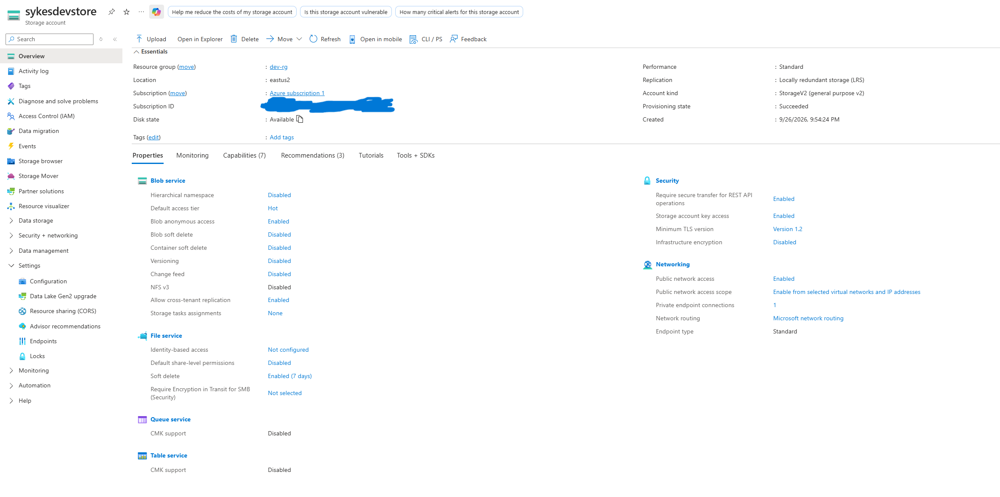
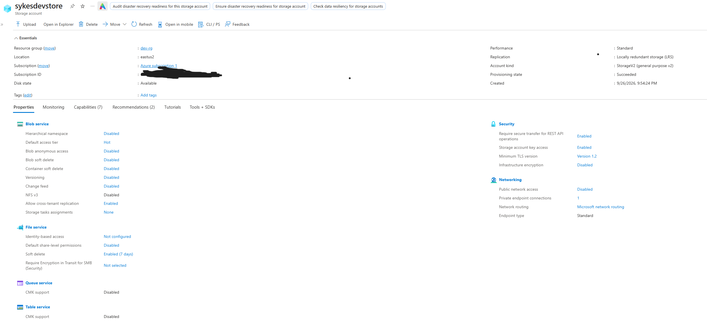
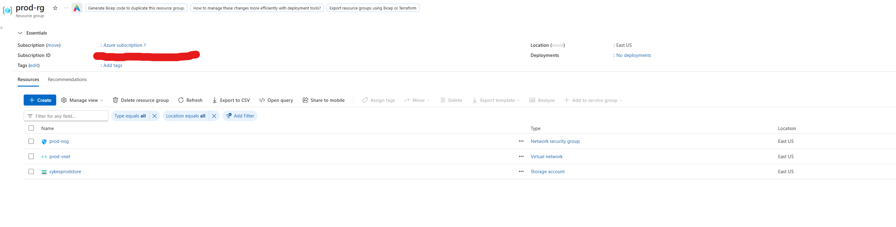
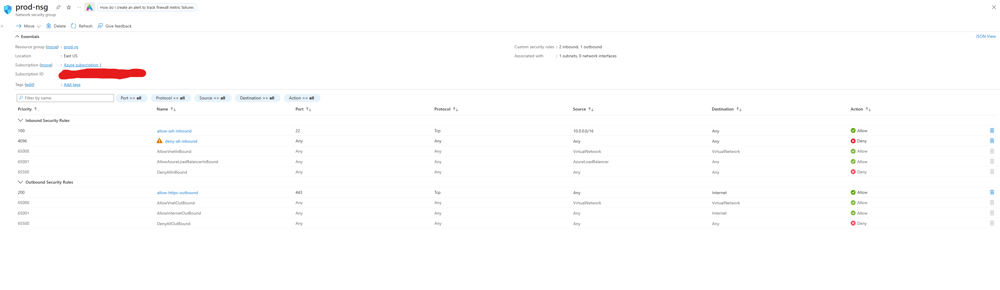

# 🏗️ Personal Azure Infrastructure with Terraform IaC
### Hub & Spoke Network · Least-Privilege NSGs · Private Storage · Modules · Remote State


A secure, repeatable Azure environment defined entirely in Terraform: no portal clicks to build it, every resource in version control, and a new environment added by editing one data file.

**Jump to:** [The problem](#1-the-business-problem) · [Resources and why](#2-azure-resources-and-why-they-are-here) · [Architecture decisions](#3-key-architectural-decisions) · [Deploy it](#4-how-to-deploy) · [Docs](#documentation)

---

## 1. The Business Problem

Organizations, federal contractors especially, rebuild the same environment types (dev, staging, production, recovery) again and again across projects and security boundaries. Built by hand in a portal, that creates three recurring problems:

| Problem | What it costs | How this project addresses it |
|---|---|---|
| **Inconsistency**: two people clicking through the portal build slightly different environments | Audit findings (FedRAMP, CMMC), hard-to-trace bugs, security drift between dev and prod | Prod is built from the same modules as dev, so parity is guaranteed by construction |
| **No audit trail**: portal changes leave no reviewable record | Cannot prove what was built, when, or by whom | Git history plus reviewed `terraform plan` output is the change record |
| **Slow, error-prone rebuilds**: recreating a network by hand takes days | Long recovery after an incident; slow onboarding of new contracts | `terraform apply` rebuilds the environment in minutes; adding an environment is a data change |

It also addresses two security problems common to cloud environments: **flat networks** (one compromised host reaches everything) and **publicly reachable storage** (a leading cause of cloud data exposure). Both are closed by default here.

This project is the next step after my CLI-based work in [Linux to Azure: Automated Log Backup](https://github.com/MrBSykes/linux-to-azure-automated-syslog-backup). That project built resources by hand with the Azure CLI; this one defines them as code.

**Status:** 20 resources deployed and tracked in Terraform state, built from three reusable modules. A Linux VM and Azure Bastion are written and plan cleanly, but sit behind cost switches that default to off.

---

## 2. Azure Resources and Why They Are Here

Every resource has a job. Nothing is included just to make the diagram look fuller.

| Resource | Count | Why it is here | Business problem it solves |
|---|---|---|---|
| **Resource groups** (`hub-rg`, `dev-rg`, `prod-rg`) | 3 | One lifecycle and permission boundary per environment | Clean ownership, cost tracking per environment, and safe teardown of one environment without touching another |
| **Virtual networks** (`hub-vnet` 10.0.0.0/16, `dev-vnet` 10.1.0.0/16, `prod-vnet` 10.2.0.0/16) | 3 | Isolated private networks with non-overlapping address space | Environment isolation; overlapping ranges make later connections impossible, so the IP plan comes first |
| **VNet peerings** (hub-to-dev, dev-to-hub, hub-to-prod, prod-to-hub) | 4 | Connect each spoke to the hub over the Microsoft backbone. Peering must be created from both sides | Shared services live once in the hub instead of being duplicated per environment |
| **Subnets** (`GatewaySubnet`, dev and prod `private-subnet`) | 3 | `GatewaySubnet` is reserved for a future VPN or ExpressRoute gateway. Private subnets hold workloads and are where NSGs attach | Gives policy something to attach to; subnet-level control is the unit auditors review |
| **Network security groups** (`dev-nsg`, `prod-nsg`) and associations | 4 | Stateful packet filter on each private subnet: default deny inbound, SSH only from the hub, HTTPS outbound | Limits blast radius; a short, readable rule list for an audit |
| **Storage accounts** (`sykesdevstore`, `sykesprodstore`) | 2 | TLS 1.2, default-deny network rules, public network access off, anonymous blob access off | Removes the most common cloud data-exposure paths at the resource level |
| **Private endpoint** (`dev-storage-pe`) and its NIC | 1 (+NIC) | Gives the dev blob service a private IP inside the dev subnet, the only path in once public access is off | Storage reachable from the private network without ever crossing the public internet |
| **Remote state** (`TerraformStateRG` / `sykestfstate` / `tfstate`) | created with CLI | Holds Terraform state in Azure Blob with lease locking | State is the record of what Terraform manages; on one laptop it is a single point of failure |
| **Linux VM + Azure Bastion** (switch, default off) | 5 when on | A no-public-IP VM and a managed access path to it | Remote administration without exposing ports 22 or 3389 to the internet |

---

## 3. Key Architectural Decisions

Each decision is recorded with the reasoning and the trade-off accepted.

| # | Decision | Reasoning | Trade-off / what I would change |
|---|---|---|---|
| 1 | **Hub-and-spoke topology** | Standard enterprise layout: shared services in one hub, workloads in isolated spokes | More moving parts than one flat VNet. Peering is non-transitive and no firewall exists, so spokes are *isolated*, not *inspected*. Inspection would need Azure Firewall plus user-defined routes |
| 2 | **Dev and prod peer only to the hub, never to each other** | A compromise in one environment has no direct network path to the other | Cross-environment traffic needs a deliberate change |
| 3 | **Three non-overlapping /16 ranges planned up front** | Overlapping address space blocks peering and cannot be fixed without rebuilding the network | Generous ranges; a real deployment would track allocations in an IPAM table |
| 4 | **Explicit `deny-all-inbound` at priority 4096** | Azure treats peered networks as part of the `VirtualNetwork` tag, so the default `AllowVnetInBound` rule (65000) would let the hub reach every port. An explicit deny at 4096 is evaluated first and closes that | Outbound is **not** default-deny: the default `AllowInternetOutBound` (65001) is still in force, so the HTTPS rule documents intent but restricts nothing. A fuller design adds deny-all outbound and flow logs |
| 5 | **SSH allowed only from the hub address range** | Least privilege: management access comes from the shared-services network, never the internet | Fixed source range; would move to application security groups once VMs exist |
| 6 | **Storage: public access off + private endpoint** | Closes public exposure at the resource, not by relying on users to behave | The private endpoint bills hourly plus per GB (about $7 to $8 a month), and **no private DNS zone is linked yet**, so private name resolution is not demonstrated. Endpoint and DNS zone should ship as one unit |
| 7 | **Reusable modules; environments defined as data** (`spokes.auto.tfvars`, `for_each`) | One definition applied everywhere: prod matches dev by construction, and adding an environment is a data change | I retrofitted modules after building a flat config. Writing the module before the second environment exists avoids the refactor |
| 8 | **`moved` blocks for the refactor** | Tells Terraform an old address and a new address are the same real resource, so state is renamed instead of destroy-and-recreate. 14 resources moved; the plan ended at 0 add, 0 change, 0 destroy | Needs a state backup and a plan review before any apply |
| 9 | **State in a separate storage account, created with the CLI** | Terraform cannot store state in a resource it has not yet created. It also let state survive a disabled subscription: after upgrading, `plan` reported "No changes" | One state file holds hub, dev and prod, so a bad dev apply could reach prod. Better: one state per environment, with versioning and soft delete |
| 10 | **VM and Bastion behind `enable_vm` / `enable_bastion` switches (default false)** | Anything billed hourly should be a deliberate decision. The code is reviewable and the plan is the evidence (5 to add), but nothing runs | A timed demo (apply, capture, destroy) is needed for live screenshots. Cross-region Bastion over global peering is unproven until applied |
| 11 | **Bastion Basic SKU, not Developer** | The free Developer SKU does not support VNet peering, so it cannot reach a VM in a spoke from the hub | Basic is dedicated and billed hourly from creation, which is why it stays off |
| 12 | **`subscription_id` through an environment variable** | Keeps identifiers out of files and out of Git | Slightly more setup per shell session |
| 13 | **Hub and dev in different regions** | An artifact of free-tier VM capacity trouble during the original build | Makes hub-to-dev a global peering with per-GB data charges. A fresh build would use one region |

### Known limitations (stated, not hidden)

- No private DNS zone for the storage private endpoint yet
- Outbound NSG traffic is not default-deny and there are no flow logs
- Single state file for all environments
- VM and Bastion are not deployed, so cross-region Bastion access is unverified
- Spokes are isolated but not inspected (no firewall or route tables)

---

## Architecture

```
                  ┌───────────────────────────┐
                  │ hub-vnet  10.0.0.0/16     │
                  │ GatewaySubnet 10.0.0.0/24 │
                  │ (AzureBastionSubnet 10.0.1.0/26, off by default)
                  └─────────┬───────────┬─────┘
                  VNet peering         VNet peering
                  (both directions)    (both directions)
              ┌─────────────┘           └─────────────┐
   ┌──────────▼───────────┐                ┌──────────▼───────────┐
   │ dev-vnet 10.1.0.0/16 │                │ prod-vnet 10.2.0.0/16│
   │ private-subnet       │                │ private-subnet       │
   │  10.1.1.0/24         │                │  10.2.1.0/24         │
   │  ├ dev-nsg           │                │  └ prod-nsg          │
   │  └ dev-storage-pe ───┼─► sykesdevstore│                      │
   └──────────────────────┘   (public      └──────────────────────┘
                               access off)   sykesprodstore (public
                                             access off, no private
                                             endpoint yet)

Remote state: TerraformStateRG / sykestfstate / tfstate
```

### NSG rules (`dev-nsg` and `prod-nsg`)

| Rule | Priority | Direction | Source | Port | Action |
|---|---|---|---|---|---|
| allow-ssh-inbound | 100 | Inbound | 10.0.0.0/16 (hub range) | 22 | Allow |
| allow-https-outbound | 200 | Outbound | Any | 443 to Internet | Allow |
| deny-all-inbound | 4096 | Inbound | Any | Any | Deny |

---

## 4. How to Deploy

### Prerequisites

- [Terraform](https://developer.hashicorp.com/terraform/install) 1.3 or newer (`winget install HashiCorp.Terraform` on Windows)
- [Azure CLI](https://learn.microsoft.com/cli/azure/install-azure-cli), signed in with `az login`
- An Azure subscription where you can create resources (a pay-as-you-go or trial subscription works; the core build costs very little, see [Cost](#cost))
- Git

### Step 1: Clone the repository

```bash
git clone https://github.com/MrBSykes/personal-azure-infrastructure-terraform-IAC.git
cd personal-azure-infrastructure-terraform-IAC/terraform
```

### Step 2: Create the remote state backend (once, with the CLI)

Terraform cannot store state in a resource it has not yet created, so this one piece is built by hand.

```bash
az group create --name TerraformStateRG --location eastus

az storage account create \
  --name <your-unique-state-account> \
  --resource-group TerraformStateRG \
  --location eastus \
  --sku Standard_LRS \
  --min-tls-version TLS1_2

az storage container create \
  --name tfstate \
  --account-name <your-unique-state-account>
```

Storage account names are globally unique (3 to 24 lowercase letters and digits). Update the `backend` block in `terraform/providers.tf` to match your account name.

### Step 3: Make the names yours

Edit `terraform/spokes.auto.tfvars`. The storage account names (`sykesdevstore`, `sykesprodstore`) are taken, so choose your own. This file holds no secrets, so it is committed on purpose.

```hcl
spokes = {
  dev = {
    location             = "eastus2"
    address_space        = "10.1.0.0/16"
    subnet_prefix        = "10.1.1.0/24"
    storage_account_name = "<your-unique-dev-name>"
    private_endpoint     = true        # costs money per hour; set false to skip
  }
  prod = {
    location             = "eastus"
    address_space        = "10.2.0.0/16"
    subnet_prefix        = "10.2.1.0/24"
    storage_account_name = "<your-unique-prod-name>"
  }
}
```

Adding an environment is a new entry in this map, not new code.

### Step 4: Set your subscription

```powershell
# PowerShell
$env:TF_VAR_subscription_id = az account show --query id -o tsv
```
```bash
# bash
export TF_VAR_subscription_id=$(az account show --query id -o tsv)
```

The ID travels through the environment, so it never lands in a file. (Alternatively, copy `terraform.tfvars.example` to `terraform.tfvars`, which is gitignored.)

### Step 5: Run Terraform

```bash
terraform init      # downloads the provider, installs modules, configures the backend
terraform fmt       # optional: format
terraform validate  # optional: check syntax
terraform plan      # review exactly what will be created
terraform apply     # build it (type yes)
```

A fresh deployment creates 20 resources. Always read the plan before applying.

### Optional: preview the VM and Bastion (costs nothing)

The VM and Bastion are off by default. To see what they would add without creating anything:

```bash
terraform plan -var enable_vm=true -var enable_bastion=true -var 'ssh_public_key=<your RSA public key>'
```

This shows 5 resources to add. **Do not apply it casually:** Bastion bills hourly from creation until deletion. If you do a demo, apply, capture screenshots, and `terraform destroy` in the same sitting. Azure Linux VMs require an RSA key, not ED25519.

### Tear it down

```bash
terraform destroy
```

This removes everything Terraform manages. The state account created in Step 2 is separate and stays until you delete it.

### Cost

| Item | Cost behavior |
|---|---|
| VNets, peerings (same region), NSGs, resource groups | Free |
| Storage accounts | Pennies at this usage |
| Dev private endpoint | About $0.01 per hour plus per GB, so roughly $7 to $8 a month. Set `private_endpoint = false` to avoid it |
| Global peering (hub East US to dev East US 2) | Per GB of data transferred |
| Azure Bastion (Basic) | Hourly while it exists; off by default |

Set a low budget alert in Cost Management before applying anything billable. Pay-as-you-go has no hard cap, and a budget alert emails you but does not stop spending.

---

## Repository Layout

```
.
├── README.md
├── terraform/
│   ├── providers.tf               # provider version and remote backend
│   ├── variables.tf               # subscription_id and the spokes map
│   ├── hub.tf                     # hub resource group, VNet, GatewaySubnet
│   ├── spokes.tf                  # calls the three modules once per spoke
│   ├── spokes.auto.tfvars         # dev and prod defined as data (no secrets)
│   ├── moved.tf                   # state moves from the old flat layout
│   ├── switches.tf                # enable_vm / enable_bastion cost switches (default false)
│   ├── vm.tf                      # dev test VM, off by default
│   ├── bastion.tf                 # hub Bastion, off by default
│   ├── terraform.tfvars.example
│   ├── .terraform.lock.hcl        # pins provider versions
│   └── modules/
│       ├── spoke-network/         # resource group, VNet, subnet, both peerings
│       ├── baseline-nsg/          # default-deny NSG and subnet association
│       └── secure-storage/        # storage account and optional private endpoint
├── docs/
│   ├── personal-azure-infrastructure-terraform-documentation.pdf      # original, Sept 2026
│   └── personal-azure-infrastructure-terraform-documentation-v2.pdf   # Oct 2026
└── screenshots/                   # Azure portal screenshots of the deployed resources
```

---

## Screenshots

| # | Screenshot | What it shows |
|---|---|---|
| 01 |  | `dev-rg`: NSG, private endpoint and its NIC, VNet, storage account |
| 02 |  | `hub-rg`: hub VNet |
| 03 |  | `prod-rg` before stage 2: prod VNet only |
| 04 |  | `TerraformStateRG`: the state storage account |
| 05 |  | Resource visualizer: dev VNet linked to hub VNet, NSG and private endpoint |
| 06 |  | `dev-nsg` inbound and outbound rules |
| 07 |  | `sykesdevstore` **before** the fix: public network access and anonymous blob access still enabled |
| 08 |  | Hub peerings to prod and dev: Connected, Fully Synchronized |
| 09 |  | Dev to hub peering: Connected |
| 10 |  | Prod to hub peering: Connected |
| 11 |  | `sykesdevstore` **after** the fix: public network access Disabled, anonymous blob access Disabled, one private endpoint connection |
| 12 |  | `prod-rg` after stage 2: NSG, VNet, `sykesprodstore` |
| 13 |  | `prod-nsg`: same baseline rules as dev |

Screenshots 07 and 11 show a gap found in review (the dev storage account was still reachable from selected public networks), fixed in code, and re-verified in the portal.

---

## Troubleshooting Log

| # | Issue | Root cause | Resolution |
|---|---|---|---|
| 1 | `terraform init`: `az` executable not found | Azure CLI was on the Ubuntu box, not the Windows machine running Terraform | Installed Azure CLI on Windows and restarted VS Code |
| 2 | `plan` failed registering resource providers | Free tier lacks permission for automatic registration | Registered Microsoft.Network, Compute and Storage with `az provider register` |
| 3 | ED25519 SSH key rejected for the VM | Azure Linux VMs accept only RSA keys | Generated a dedicated RSA 4096 key for Azure |
| 4 | `SkuNotAvailable` for B1s and B1ms | No free-tier B-series capacity in East US or East US 2 | VM left out; code kept and later moved behind a switch |
| 5 | Peering "inconsistent result" after changing dev to East US 2 | Peering existed in Azure but was no longer in state | Brought it back with `terraform import` |
| 6 | Push rejected: provider binary over 100 MB | `.terraform/` was committed before a `.gitignore` existed | Added `.gitignore`, removed the binary from history with `git filter-branch`, force pushed |
| 7 | Subscription disabled when the free trial credit expired | Free accounts are disabled at 30 days or when the $200 credit runs out | Upgraded to pay-as-you-go; `terraform plan` then showed "No changes", proving state and resources survived |
| 8 | `terraform plan` prompted for `subscription_id` | The gitignored `terraform.tfvars` was not present after reorganizing the repo | Passed it through `TF_VAR_subscription_id` instead of a file |
| 9 | `Module not installed` errors before any plan | New modules must be installed by `terraform init` first | Ran `terraform init`, then re-ran the state backup and plan |
| 10 | New `spokes.auto.tfvars` silently ignored by Git | `.gitignore` excluded all `*.tfvars` | Added the exception `!spokes.auto.tfvars` after the `*.tfvars` line |

The full table with business lessons is in the PDFs.

---

## What I Would Do Differently Next Time

1. Plan the IP space first, including the Bastion and firewall subnets, and keep everything in one region.
2. Create the `.gitignore` (and the tfvars exception) before the first commit.
3. Write the modules before the second environment exists.
4. Use one state file per environment, with versioning and soft delete on the state account.
5. Ship each private endpoint together with its private DNS zone.
6. Make outbound NSG rules truly default-deny and turn on flow logs.
7. Set a budget alert before creating anything billable.
8. Run `fmt`, `validate` and `plan` automatically on every pull request.

---

## Next Steps

- [x] Add an NSG and storage account to the prod spoke
- [x] Refactor into modules with spokes defined as data
- [ ] Add a private DNS zone (`privatelink.blob.core.windows.net`), a VNet link and a DNS zone group so the storage name resolves to the private endpoint IP from inside the VNet
- [ ] Run a timed Bastion and VM demo (flip `enable_vm` and `enable_bastion`, capture screenshots, destroy)
- [ ] Split state per environment so a bad dev apply cannot touch prod
- [ ] Add CI that runs `terraform fmt`, `validate` and `plan` on pull requests

---

## Skills Demonstrated

Infrastructure as Code (Terraform), Azure hub and spoke networking, VNet peering, NSG design, private endpoints, remote state management, safe refactoring with `moved` blocks, importing existing resources into state, cost control, Git hygiene for IaC projects, and written troubleshooting documentation.

**Certifications this supports:** AZ-900 (passed September 24, 2026) and CompTIA Security+. It also lines up with the AZ-104 networking domain, which is the next goal.

## Documentation

- **[Version 2 write-up (October 2026)](docs/personal-azure-infrastructure-terraform-documentation-v2.pdf)**: module refactor, prod controls, what each component does in Azure, the business problem it solves, and what I would do differently.
- [Original write-up (September 2026)](docs/personal-azure-infrastructure-terraform-documentation.pdf): the first version, kept for the project history.

## Related Projects

- [Linux to Azure: Automated System Log Backup](https://github.com/MrBSykes/linux-to-azure-automated-syslog-backup)
- [ServiceNow Help Desk Lab](https://github.com/MrBSykes/servicenow-help-desk-lab)

---

*Bryan Sykes | Home Lab Portfolio | 2026*
*[](https://github.com/MrBSykes) [](https://x.com/SecuredByBryan)*
